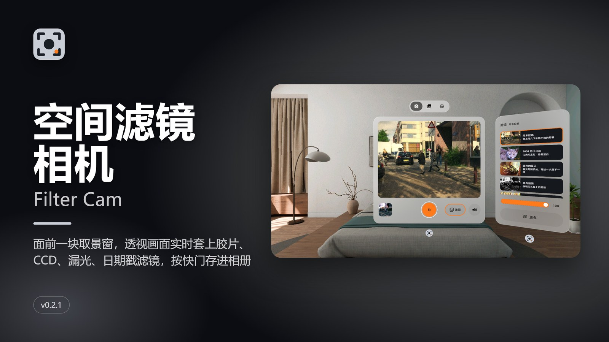
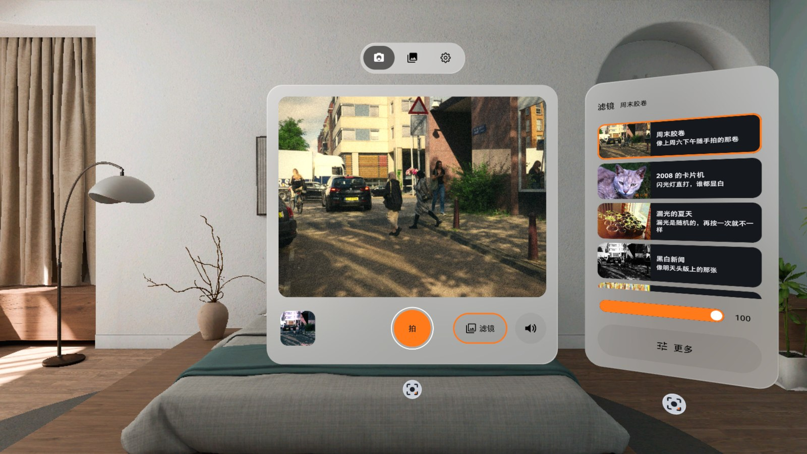
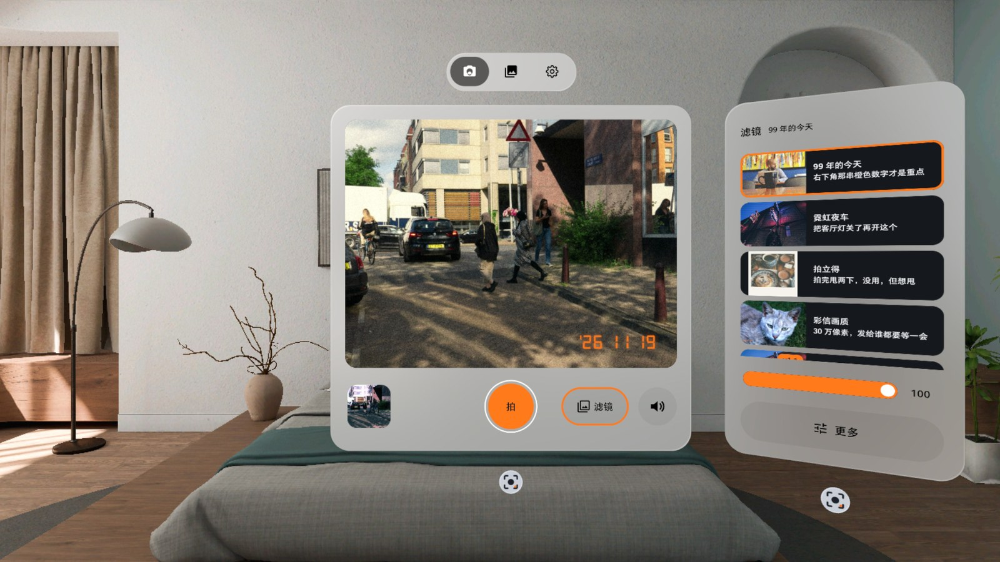
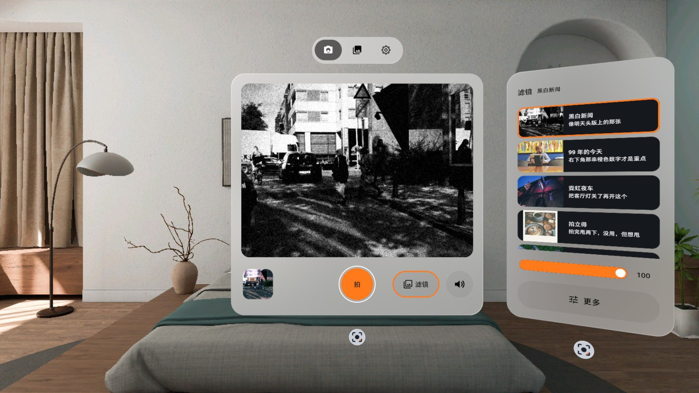
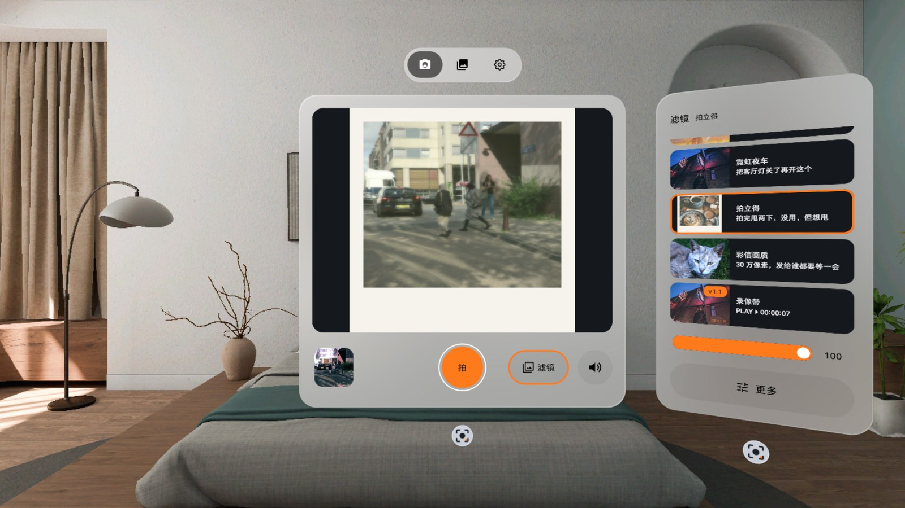
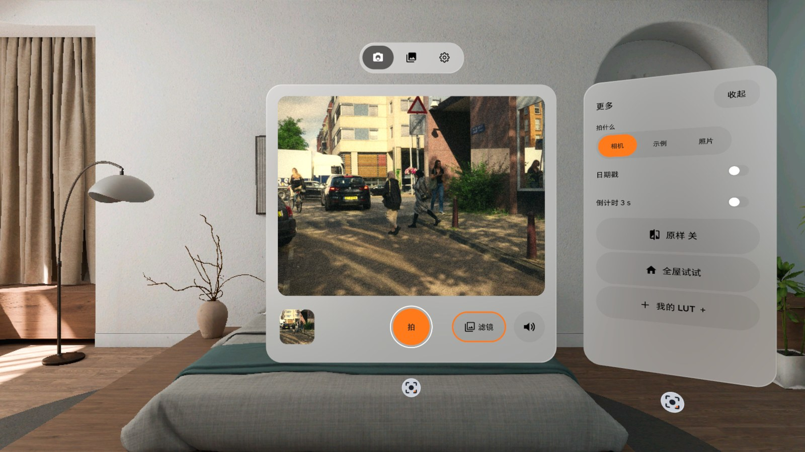
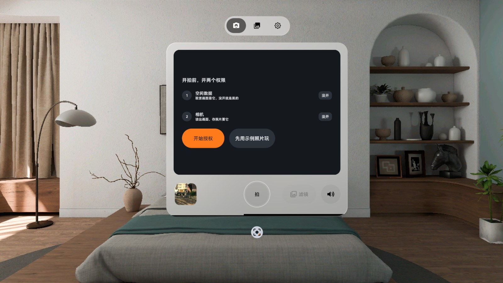

# 空间滤镜相机 Filter Cam



**中文** · [English](#english)

把手机上那种有网感的滤镜相机搬进 PICO 头显。面前一块取景窗，透视相机画面实时套上胶片、CCD、漏光、日期戳滤镜；看中了就按快门，照片落在角落的缩略图里，点开就是相册。

## 功能

- **8 个滤镜 + 我的 LUT**：周末胶卷、2008 的卡片机、漏光的夏天、黑白新闻、99 年的今天、霓虹夜车、拍立得、彩信画质；强度可调，漏光和颗粒每张都不一样；导入自己的 `.cube` LUT（17 / 33 / 65 格）当第 9 个滤镜。
- **一窗取景**：主窗口是取景窗 + 快门 + 页签（拍照 / 相册 / 设置），滤镜卡片在右边的小窗里，看一眼就预览。
- **拍照与相册**：拍完闪一下、照片飞进角落缩略图；相册打开就是最新一张，删除先确认；也能导入自己的照片重新出片。
- **全屋模式**：把漏光、颗粒、暗角、日期戳铺到整个透视世界，摇杆左右翻滤镜。
- **权限**：首次打开按顺序申请空间数据和相机，拒绝了会点名缺哪一项、去设置哪里打开。
- 中英双语，不联网，不需要账号。照片保存在 `Pictures/FilterCam`。

## 截图

> 截图在模拟器里拍。模拟器没有相机画面，取景窗里是调试命令喂进去的示例照片，走的是真实滤镜管线。

| | |
|---|---|
|  |  |
|  |  |
|  |  |

演示视频见 [Release v0.2.1](https://github.com/kejing-dev/FilterCam/releases/tag/v0.2.1)（模拟器调试输入驱动，**非真实手势录像**）。

## 安装

需要 PICO OS 6（Spatial SDK 6.1.9）。从 [Releases](https://github.com/kejing-dev/FilterCam/releases) 下载 `FilterCam-v0.2.1.apk`：

```bash
adb install -r FilterCam-v0.2.1.apk
pico-cli app launch io.embodit.filtercam
```

Release 上的 APK 是 `assembleRelease` 出的未签名包，供上架平台托管签名；自己装到头显上请先用自己的 key 签名，或从源码 `./gradlew assembleDebug`。

## 构建

```bash
./gradlew testDebugUnitTest assembleDebug
```

技术路线：取景用 SpatialML 回读右眼相机帧（双缓冲流水线），和成片走同一个 FilterEngine（33³ LUT + 颗粒 / 暗角 / 漏光 / 日期戳）；全屋模式是 Full Space 下的自定义 Shader 罩，只铺能叠加的效果。

---

## English

Filter Cam brings a phone-style retro filter camera to the PICO headset. A viewfinder floats in front of you and runs film, CCD, light-leak and date-stamp looks on the live passthrough camera. Press the shutter, the photo lands in the corner thumbnail, tap it for the album.

- **8 filters + My LUT**: Weekend Roll, Point-and-shoot '08, Light-leak Summer, Front Page B&W, Dated '99, Neon Night Drive, Instant Square, MMS Quality. Adjustable strength; leaks and grain change every shot. Import your own `.cube` LUT (17 / 33 / 65) as a ninth filter.
- **One-window camera**: viewfinder, shutter and tabs (Shoot / Album / Settings) in the main window, filter cards in a side window; look at a card to preview it.
- **Album**: flash, the photo flies to the corner thumbnail, the album opens on the newest photo, delete asks first. Re-develop your own imported photos with the same filters.
- **Room mode**: spreads leaks, grain, vignette and the date stamp over the whole passthrough world.
- **Permissions**: asks for Spatial Data, then Camera, one at a time, and names the missing one if you refuse.
- Chinese and English, offline, no account.

Screenshots are from the emulator, which has no camera: the viewfinder shows a sample photo fed in by a debug command, through the real filter pipeline. The demo video is driven by debug input, **not a real hand-gesture recording**.

Install: `adb install -r FilterCam-v0.2.1.apk`, then `pico-cli app launch io.embodit.filtercam`. The Release APK is an unsigned `assembleRelease` build for store-side signing.
